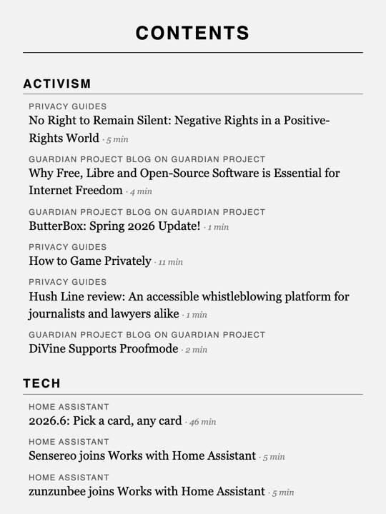

# 📰 kindle_daily

**Your RSS backlog, delivered to your Kindle as a morning newspaper.**

<p align="center">
  
  &nbsp;
  
  &nbsp;
  
</p>
<p align="center"><sub>Cover · contents by category · article. Sample issue built by the real pipeline from
<a href="https://www.privacyguides.org/">Privacy Guides</a> (CC BY-SA 4.0),
<a href="https://guardianproject.info/blog/">Guardian Project</a> (CC BY) and
<a href="https://www.home-assistant.io/blog/">Home Assistant</a> (CC BY-NC-SA 4.0); photo via Unsplash.</sub></p>

A daily Python job that turns your FreshRSS unread queue into a magazine-style
EPUB and emails it to your Kindle's Send-to-Kindle address. The Kindle picks it
up over wifi the next time it's online — no cable, no manual sideloading.
Articles included in the issue are marked read in FreshRSS so they don't
reappear tomorrow.

Each daily run produces **one combined EPUB** ("Kindle Daily — <date>") with
every FreshRSS category as its own section in the table of contents. Categories
are ordered by article count (most articles first); articles whose feed has no
category appear in a "Misc" section. If the combined EPUB exceeds `MAX_EPUB_MB`,
it is split into multiple **Part N** EPUBs that break on category boundaries and
each fit under the cap — Gmail's 25 MB SMTP ceiling stops being a backlog
problem. The whole issue is built before anything is sent, so a build failure
ships nothing (and tomorrow's run retries); each Part is then sent and marked
read independently.

## How it works

```
freshrss-api  ──►  selector  ──►  fetcher  ──►  chunker  ──►  epub builder  ──►  smtp sender  ──►  mark-as-read
   (greader)        (filters)     (trafilatura)  (category    (ebooklib)        (Gmail)         (greader)
                                                  boundaries)
```

1. **`freshrss.list_items`** — calls FreshRSS's Google Reader-compatible API to
   pull every unread item, with feed and category metadata. Auto-syncs with feed
   changes; no static config to maintain.
2. **`fetcher.fetch_all`** — uses [trafilatura](https://trafilatura.readthedocs.io)
   to extract clean full text from each article URL. Falls back to whatever
   summary FreshRSS already has if extraction fails. Skips images.
3. **`chunker.split`** — orders categories by article count and packs whole
   categories into size-capped Parts, breaking on category boundaries. A single
   category that overflows the cap on its own is split mid-category as a
   fallback.
4. **`epub_builder.build`** — assembles a magazine-style EPUB 3 with cover, an
   in-document clickable contents page, section openers per FreshRSS category,
   and one styled chapter per article. Both EPUB3 nav and legacy NCX are
   populated, so the Kindle's hamburger TOC works out of the box.
5. **`mailer.send`** — emails each Part to your `@kindle.com` address via Gmail
   SMTP.
6. **`freshrss.mark_read`** — only after a confirmed 250 OK from SMTP, marks that
   Part's items as read. If anything fails upstream, those items aren't marked,
   so tomorrow's run is a safe retry.

## Getting started

### Prerequisites

- Python 3.11+
- A FreshRSS instance with the API password set (FreshRSS user profile →
  "External access" → set an API password — this is **separate** from your
  login password).
- A Gmail account with a 16-character app password
  ([create one](https://myaccount.google.com/apppasswords)).
- The Gmail address added to your Amazon
  [approved sender list](https://www.amazon.com/sendtokindle).

### Local development (Mac)

```bash
git clone <this repo> ~/kindle_daily   # or use the existing project dir
cd ~/kindle_daily
python3 -m venv .venv
source .venv/bin/activate
pip install -e ".[dev]"
pre-commit install   # Black, Ruff, YAML/JSON/TOML checks on every commit
cp .env.example .env
# edit .env with your real values
```

Build an EPUB without sending or marking-as-read (safe to run repeatedly):

```bash
python -m kindle_daily.main --dry-run
open out/kindle_daily_*.epub   # eyeball it in Apple Books
```

Once happy, do a one-shot real send:

```bash
python -m kindle_daily.main
```

Run the tests and the full lint/format suite:

```bash
pytest
pre-commit run --all-files
```

Style: Black formats, Ruff lints (including pyupgrade). f-strings everywhere
*except* logging calls, which keep lazy `%s` args (`log.info("sent %s", path)`)
so messages are only built when the level is enabled — Ruff's `G` rules enforce this.

### Raspberry Pi deployment

```bash
git clone <this repo> ~/kindle_daily
cd ~/kindle_daily
./install.sh          # creates .venv, installs deps, adds cron line
cp .env.example .env  # then edit with real values
chmod 600 .env
./run.sh              # smoke test
```

The installer adds a cron line that fires `run.sh` every day at `RUN_AT`
(device-local time, default 05:00). Changing `RUN_AT` only takes effect after
re-running `./install.sh`. Logs land in `logs/run-YYYY-MM-DD.log`; EPUBs and logs older than
`RETENTION_DAYS` are deleted at the start of each run.

To update, `git pull` on the Pi. The package is installed in editable mode, so
the next cron run picks up the change; re-run `./install.sh` if
`pyproject.toml` or the cron line changed, and add any new `.env` keys by hand.

## Configuration

All configuration is via `.env`. See [`.env.example`](./.env.example) for the
full list. Key knobs:

| Var | Default | Purpose |
|---|---|---|
| `MAX_EPUB_MB`  | 15 | Per-Part EPUB size cap. If the day's combined EPUB doesn't fit under this size, the chunker splits it into multiple **Part N** EPUBs (breaking on category boundaries), each under the cap. Gmail's outbound SMTP cap is 25 MB on the base64-encoded message (~18 MB raw); 15 MB leaves headroom for encoding overhead. About 1 MB of each Part is reserved for the cover and EPUB scaffolding; a single article bigger than the remainder is skipped and left unread. |
| `MAX_AGE_DAYS` | 7 | Only include articles whose **published date** is within this many days. Filter is applied client-side after the FreshRSS fetch; items the feed exposes without a timestamp are kept (with a warning) so a malformed feed doesn't silently lose articles. |
| `RUN_AT` | 05:00 | Daily run time in device-local time, e.g. `17:00`, `"5:30 PM"`, `5PM`. Read by `install.sh` when it writes the cron line, so re-run `./install.sh` after changing it. |
| `RETENTION_DAYS` | 30 | Days to keep built EPUBs in `out/` and daily logs in `logs/`. Older files are deleted by `run.sh` at the start of each run. |
| `EXCLUDED_CATEGORIES` | *(empty)* | Comma-separated FreshRSS category names to skip (e.g. `Comics,Memes`). Applied client-side after the FreshRSS fetch — FreshRSS's GReader API only supports the read/unread/starred values for its `xt` exclude filter, so label exclusion can't be done server-side. |

When the day's issue is split into more than one Part, the EPUBs are titled
`Kindle Daily Part N — <date>` (filenames carry a matching `_partNofM` suffix)
and the email subject shows `Part N/M`, so the Parts land as distinct items in
the Kindle library and are easy to tell apart on the device.

### Verify your config

After editing `.env`, run the pre-flight validator to confirm the file is
parseable and that list-valued vars tokenised the way you expected. It
doesn't fetch, build, or send anything — it just prints what the rest of
the application will see, with the two passwords masked.

```
./run.sh check-config                  # via run.sh
python -m kindle_daily.check_config    # equivalent, from an active venv
```

Sample successful output:

```
Config:
  freshrss_url (str) = 'http://nas.local:8080'
  freshrss_user (str) = 'alice'
  freshrss_api_password (str) = <set, length 6>
  gmail_user (str) = 'alice@gmail.com'
  gmail_app_password (str) = <set, length 16>
  kindle_email (str) = 'alice_abc123@kindle.com'
  max_epub_bytes (int) = 15728640
  max_age_days (int) = 7
  excluded_categories (tuple[str, ...]) = ('Comics', 'Memes')
  out_dir (Path) = PosixPath('/path/to/kindle_daily/out')
OK — config parses cleanly.
```

On any validation problem the command exits with code `2` and prints every
issue it found in one go (not just the first), so you can fix them in one
round-trip.

## CLI usage

```
python -m kindle_daily.main                 # full run: fetch → build → send → mark read
python -m kindle_daily.main --dry-run       # build only; write to ./out/, no send, no mark
python -m kindle_daily.main --no-mark-read  # send for real, but leave items unread (first-test mode)
```
